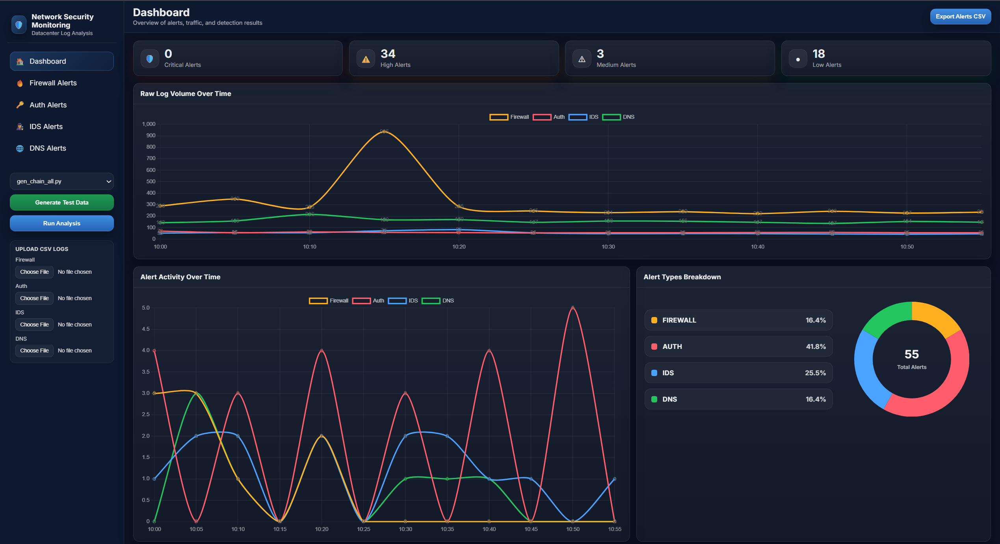
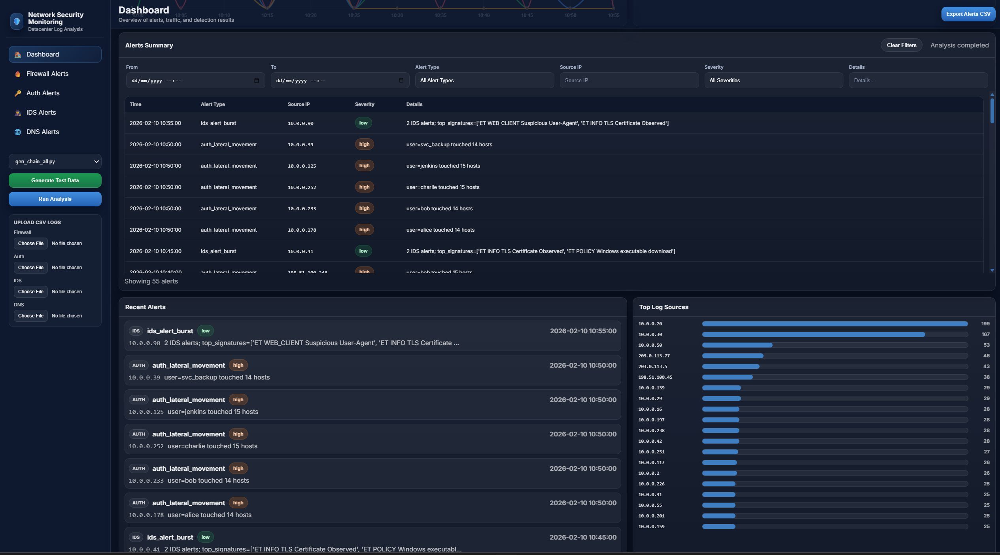
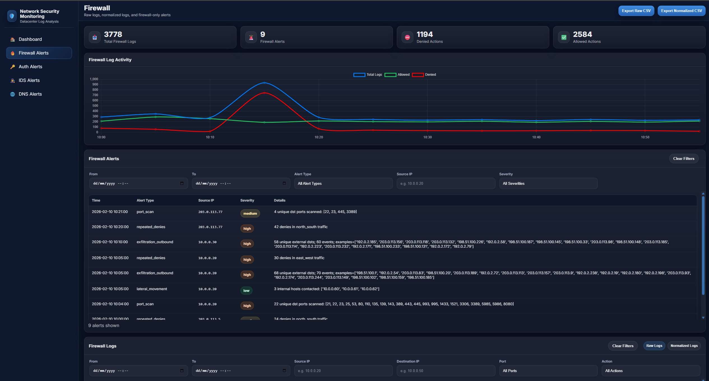
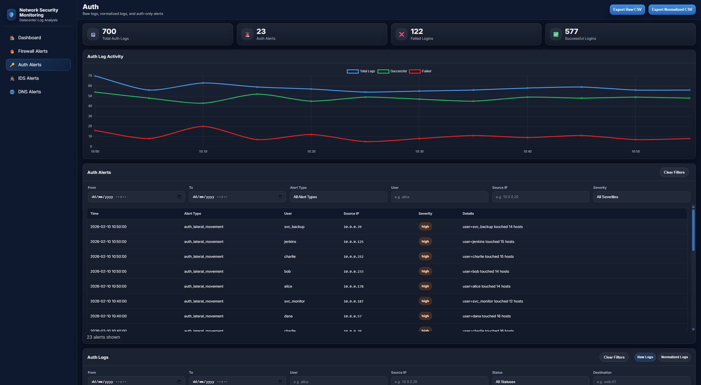
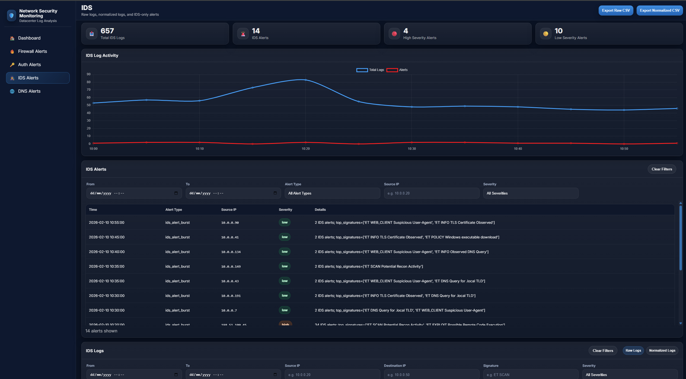
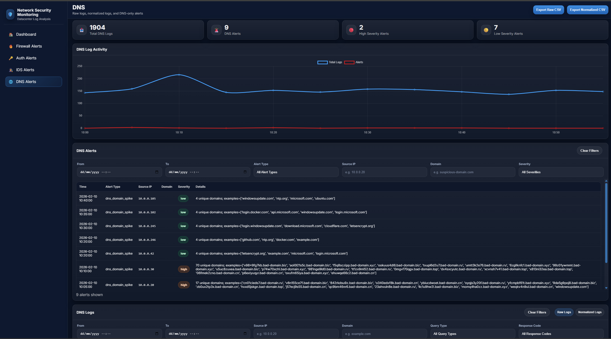

# Datacenter Security Log Analyzer

**Final Year Project | BSc Cyber Security and IT Forensics | University of Limerick | 2026**

A Python-based security log analysis and monitoring application developed to investigate security challenges in datacenter networks.

The system generates synthetic network logs, processes and normalises events from multiple sources, applies configurable threat detection rules, and visualises the results through an interactive Flask dashboard.

The application also supports the investigation of simulated multi-stage attack scenarios across firewall, authentication, intrusion detection system (IDS), and DNS logs.

## Project Overview

Modern datacenter environments generate large volumes of security logs across different systems. Identifying suspicious activity can be challenging when events are distributed across multiple log sources.

This project explores how automated log analysis can improve security monitoring and visibility.

The application demonstrates a simplified SIEM-like workflow:

1. Generate synthetic network activity and attack scenarios.
2. Collect logs from firewall, authentication, IDS, and DNS sources.
3. Parse and normalise different log formats.
4. Apply configurable rule-based detection logic.
5. Generate security alerts and analysis results.
6. Investigate events through an interactive Flask dashboard.

The project was developed as an educational proof of concept using simulated data.

## Key Features

- **Multi-source log analysis:** Processes firewall, authentication, IDS, and DNS logs.
- **Synthetic attack simulation:** Generates normal network activity and predefined multi-stage attack scenarios.
- **Log normalisation:** Converts different event formats into structured data for consistent analysis.
- **Rule-based threat detection:** Identifies suspicious activity using configurable thresholds, patterns, and time windows.
- **Interactive Flask dashboard:** Displays alerts, activity trends, severity information, and individual log-source analysis.
- **Searchable log tables:** Allows users to investigate events using filters such as IP addresses, usernames, alert types, and timestamps.
- **Cross-source investigation:** Enables users to examine related activity across different systems during simulated attack scenarios.
- **CSV exports:** Supports exporting raw logs, normalised logs, and analysis results.

## Application Screenshots

### Main Security Monitoring Dashboard

The main dashboard provides a central overview of analysed network activity.

It displays alert information, traffic trends, source statistics, and security events generated by the detection engine.



The dashboard also provides controls for selecting synthetic log generators, running the analysis, and reviewing results.



### Firewall Investigation

The Firewall Alerts page allows users to investigate network connection activity and potential security threats.

Users can:
- View firewall detection alerts.
- Examine raw and normalised firewall logs.
- Filter events by source and destination IP addresses.
- Search by destination port and firewall action.
- Investigate repeated denies, scanning behaviour, and unusual traffic patterns.
- Export raw and normalised data as CSV files.



### Authentication Investigation

The Auth Alerts page focuses on authentication activity and potentially suspicious account behaviour.

Users can:
- Review successful and failed authentication events.
- Investigate repeated login failures and suspicious access attempts.
- Examine raw and normalised authentication logs.
- Filter by username, source IP, login status, and destination.
- Review authentication-related detection alerts and severity levels.



### Intrusion Detection Investigation

The IDS Alerts page allows users to investigate intrusion detection events and signatures.

Users can:
- Review IDS alerts and severity information.
- Examine raw and normalised IDS logs.
- Filter events by source IP, destination IP, IDS signature, and severity.
- Investigate simulated scanning, exploitation, and other suspicious activity.
- Compare IDS events with related activity found in other log sources.



### DNS Investigation

The DNS Alerts page provides visibility into simulated DNS activity and unusual domain behaviour.

Users can:
- Review DNS activity and generated security alerts.
- Examine raw and normalised DNS logs.
- Filter by source IP, domain, query type, and response code.
- Investigate unusual domain activity, DNS spikes, and beaconing-like patterns.
- Compare DNS events with related network and authentication activity.



## Simulated Attack Scenarios

The application contains several Python generators designed to create synthetic network events and simulated attack scenarios.

These generators can be selected through the Flask dashboard.

| Generator | Purpose |
|---|---|
| `gen_basic_test_data.py` | Generates basic synthetic network activity for testing. |
| `gen_chain_all.py` | Generates multiple simulated attack chains in one dataset. |
| `gen_chain_external_ransomware.py` | Simulates external reconnaissance, exploitation indicators, lateral movement, and ransomware-style activity. |
| `gen_chain_insider_exfil.py` | Simulates insider or service-account misuse and potential data exfiltration activity. |
| `gen_chain_ddos_like_spike.py` | Simulates a concentrated DDoS-like traffic spike and associated network events. |

The generated scenarios provide events across multiple log sources, allowing users to investigate how different stages of suspicious activity appear within the monitoring environment.

All attack scenarios are simulated using generated data.

## Investigating an Attack Chain

A key feature of the application is the ability to investigate simulated multi-stage attacks across multiple log sources.

For example, using `gen_chain_all.py`:

1. Open the Flask dashboard.
2. Select `gen_chain_all.py` from the generator dropdown.
3. Click **Generate Test Data**.
4. Click **Run Analysis**.
5. Review the main dashboard for unusual traffic patterns and generated alerts.
6. Open the Firewall, Authentication, IDS, and DNS investigation pages.
7. Search for related source or destination IP addresses.
8. Compare timestamps, event types, and detection results to understand the simulated attack progression.

### Example Investigation

The simulated external attack includes activity involving:

- **External source IP:** `203.0.113.5`
- **Internal host:** `10.0.0.20`

Users can search for these addresses in the relevant investigation tables and review their associated events.

For example:

- **Firewall logs:** Examine connection attempts, denied traffic, and scanning activity.
- **Authentication logs:** Investigate failed login attempts and suspicious account access.
- **IDS logs:** Review intrusion signatures and exploitation indicators.
- **DNS logs:** Investigate suspicious domain queries and potential command-and-control activity.

By comparing the events across different sources, users can manually trace the simulated progression of an attack.

The application supports cross-source investigation through searchable logs and alerts. It does not automatically reconstruct complete attack chains.

## Detection Capabilities

The Python detection engine implements configurable rules for identifying potentially suspicious activity.

### Firewall Detection

- Repeated firewall deny events
- Potential port scanning
- Unusual traffic spikes
- Lateral movement patterns
- Potential outbound exfiltration-style activity

### Authentication Detection

- Repeated failed login attempts
- Successful authentication following multiple failures
- Suspicious privileged account activity
- Authentication anomalies and lateral movement indicators

### IDS Detection

- IDS alert bursts
- Suspicious intrusion signatures
- Potential exploitation indicators

### DNS Detection

- Unusual DNS activity
- Domain query spikes
- Beaconing-like behaviour

Detection thresholds and analysis settings can be adjusted through `config.yaml`.

## Technologies Used

| Technology | Purpose |
|---|---|
| Python | Log generation, parsing, analysis, and threat detection |
| Flask | Backend web application and dashboard |
| pandas | Data processing, normalisation, and analysis |
| matplotlib | Data visualisation and reporting |
| Chart.js | Interactive dashboard charts |
| HTML, CSS, JavaScript | Frontend interface and filtering |
| PyYAML | Configuration file processing |
| CSV | Synthetic log storage and analysis outputs |

## Project Structure

```text
datacenter-security-log-analyzer/
|
|-- Dashboard/
|   |-- app.py
|   |-- templates/
|   |-- static/
|
|-- src/
|   |-- main.py
|   |-- parser.py
|   |-- detectors.py
|   |-- report.py
|   |-- pipelines/
|
|-- generators/
|   |-- gen_basic_test_data.py
|   |-- gen_chain_all.py
|   |-- gen_chain_external_ransomware.py
|   |-- gen_chain_insider_exfil.py
|   |-- gen_chain_ddos_like_spike.py
|   |-- gen_common.py
|
|-- data/
|   |-- firewall.csv
|   |-- auth.csv
|   |-- ids.csv
|   |-- dns.csv
|
|-- docs/
|   |-- images/
|       |-- Dashboard-1.png
|       |-- Dashboard-2.png
|       |-- Firewall-Investigation.png
|       |-- Authentication-Investigation.png
|       |-- IDS-Investigation.png
|       |-- DNS-Investigation.png
|
|-- config.yaml
|-- requirements.txt
|-- .gitignore
|-- README.md
```

The `outputs/` folder is generated automatically when the analysis runs and is excluded from version control.

## Installation and Usage

### 1. Clone the Repository

```bash
git clone https://github.com/ItzSteve04/datacenter-security-log-analyzer.git
cd datacenter-security-log-analyzer
```


### 2. Create a Python Virtual Environment

```bash
python -m venv .venv
```

On Windows, you can use the virtual environment's Python executable directly:

```powershell
.\.venv\Scripts\python.exe -m pip install -r requirements.txt
```

Alternatively, activate your virtual environment and install the dependencies:

```bash
python -m pip install -r requirements.txt
```

### 3. Start the Flask Dashboard

```bash
python Dashboard/app.py
```

Open the following address in your browser:

http://127.0.0.1:5000

The dashboard runs locally on your computer.

### 4. Generate Synthetic Log Data

From the dashboard:

1. Select a log generator.
2. Click **Generate Test Data**.
3. Review the generator output in the dashboard console.

Alternatively, run a generator from the command line:

```bash
python generators/gen_chain_all.py
```

The generator writes synthetic events into the CSV files inside `data/`.

### 5. Run the Analysis

From the dashboard, click **Run Analysis**.

Alternatively, run:

```bash
python src/main.py
```

The analysis engine processes the input logs, applies the configured detection rules, and generates the results.

### 6. Investigate the Results

Use the main dashboard to review the generated alerts and activity charts.

Navigate between:

- Firewall Alerts
- Auth Alerts
- IDS Alerts
- DNS Alerts

Search and filter the log tables to investigate individual events and relationships between the different log sources.

## Automatically Generated Outputs

The application automatically creates the `outputs/` directory when the Python analysis engine runs.

The following subdirectories are created:

```text
outputs/
|-- global/
|-- firewall/
|-- auth/
|-- ids/
|-- dns/
```

These directories contain generated analysis results.

- `global/` contains combined alert summaries, normalised log information, and statistics.
- `firewall/` contains firewall detection and analysis results.
- `auth/` contains authentication detection and analysis results.
- `ids/` contains intrusion detection analysis results.
- `dns/` contains DNS detection and analysis results.

The output files can be recreated by running the analysis again.

For this reason, generated output files are excluded from the GitHub repository using `.gitignore`.

## Configuration

The application uses `config.yaml` to control analysis behaviour.

Configuration options include:

- Detection thresholds
- Time windows
- Log source definitions
- Input file locations
- Field mappings and normalisation settings
- IP address and port allowlists
- Detection rule settings

These options allow the detection behaviour to be adjusted for different synthetic scenarios.

## Project Scope and Limitations

This project was developed as an educational cybersecurity proof of concept.

The application uses synthetic log data generated in a controlled environment. It does not collect live enterprise network traffic or analyse genuine production incidents.

Detection is primarily rule-based and depends on predefined event patterns, thresholds, and time windows.

Although the application demonstrates SIEM-like functionality, it is not a production-ready SIEM platform.

The dashboard is intended for local demonstration and should not be exposed directly to the public internet.

## Future Improvements

Potential future enhancements include:

- Real-time log ingestion and continuous monitoring
- Automated cross-source attack-chain correlation
- Additional cloud and endpoint log sources
- Advanced anomaly detection and machine learning
- Improved scalability and performance testing
- Expanded automated testing and reporting
- Additional dashboard visualisations

## Academic Context

This application was developed independently as my Final Year Project at the University of Limerick.

**Degree:** BSc Cyber Security and IT Forensics

**Project title:** Security Challenges in Datacenter Networks: Risks and Mitigation Strategies

**Year:** 2026

The project combines cybersecurity research with practical Python development, simulated security monitoring, detection engineering, data analysis, and visualisation.
